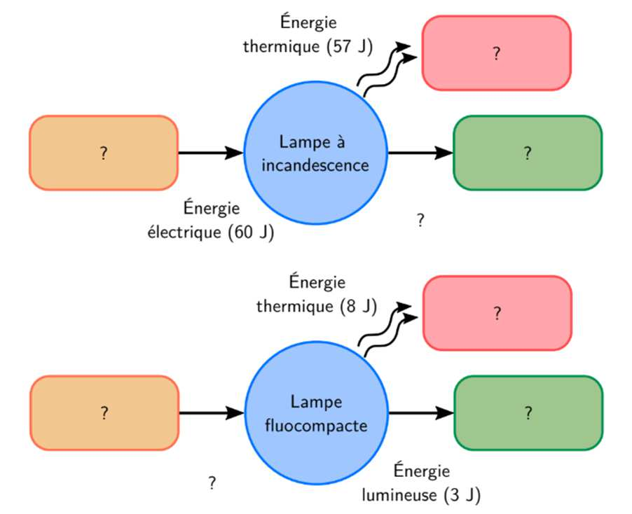

# Exercices - E1 : L’énergie et ses enjeux

## Exercice 1 : Calcul de puissances et énergies - Unités

Compléter le tableau suivant (vous détaillerez vos calculs dans votre cahier) :

| Appareil | Puissance moyenne absorbée | Durée | Énergie absorbée |
| --- | --- | --- | --- |
| **Lampe** | 50 W | 10 min | ... Wh |
| **Motrice de TGV** | 10 MW | ... h | $5 \times 10^7$ Wh |
| **Ordinateur** | 200 W | 1 h | ... J |
| **Moteur de voiture** | ... kW | 20 min | 110 MJ |

## Exercice 2 : Cuisson d’un poulet

Un four-grill de puissance moyenne 1 500 W (en fonctionnement grill), permet de cuire un poulet en 1 h 15 min.

1. Rappeler la relation qui permet de calculer l’énergie $E$ consommée par un appareil à partir de sa puissance moyenne $P$ et de la durée d’utilisation $\Delta t$.

   Indiquer les unités de $P$ et de $\Delta t$ pour que l’énergie soit exprimée en kWh.

2. Déterminer l’énergie électrique nécessaire pour la cuisson, en kWh.

Hors abonnement, le prix TTC du kWh d’électricité est voisin de 0,25 euro.

3. Quel est le coût de l’énergie électrique pour la cuisson du poulet ?

## Exercice 3 : Le moteur chauffe !

Le moteur électrique d’un tournevis sans fil, alimenté par une batterie rechargeable, de puissance électrique consommée 285 W, fournit une puissance mécanique utilisable (ou puissance utile), $P_u$, de 170 W.

On utilise cet outil pour visser une vis dans une cheville. L’opération dure 4 s.

1. Quelle est l’énergie électrique consommée durant cette opération ?

2. Quel est le travail effectué par l’outil pour insérer la vis ?

3. Quel est le rendement du moteur électrique ?

4. Après une utilisation de quelques minutes on peut percevoir que le moteur dégage de la chaleur. Justifier cette observation.

## Exercice 4 : Rendement d’une ampoule

On donne les chaînes énergétiques de deux types d’ampoules, une ampoule à incandescence et une ampoule fluocompacte.

1. Rappeler la définition du rendement d’un convertisseur.

2. Compléter les formes d’énergies manquantes ainsi que leurs valeurs.

3. Calculer le rendement de chacune de ces deux lampes.

## Exercice 5 : Énergie et puissance absorbées par un panneau solaire

Un particulier relève la valeur affichée par le compteur d’énergie électrique produite par son panneau solaire à différents moments d’une journée pas toujours très ensoleillée.

| Heures | Minuit | 0 h - 8 h | 8 h - 11 h | 11 h - 12 h |
| --- | --- | --- | --- | --- |
| Compteur électrique (kWh) | Mise à zéro : 0,0 | Relevé à 8 h 00 : 0,0 | Relevé à 11 h 00 : 1,5 | Relevé à 12 h 00 : 1,8 |
| Puissance électrique produite (kW) | | | | |

| Heures | 12 h - 15 h | 15 h - 20 h | 20 h - 0 h |
| --- | --- | --- | --- |
| Compteur électrique (kWh) | Relevé à 15 h 00 : 4,8 | Relevé à 20 h 00 : 6,3 | Relevé à minuit : 6,3 |
| Puissance électrique produite (kW) | | | |

**Attention ! Le compteur affiche l’énergie électrique accumulée.**

1. Rappeler le type de conversion effectuée par un panneau solaire photovoltaïque.

2. Déterminer la puissance électrique moyenne produite par le panneau sur chaque intervalle de temps. Compléter le tableau.

3. En déduire la puissance électrique moyenne produite sur l’ensemble de la journée.

## Exercice 6 : Groupe électrogène

Un groupe électrogène est constitué d’un moteur diesel et d’une transmission permettant de mettre en rotation un alternateur.

L’ensemble sert d’alimentation de secours à une installation électrique de 5,5 kW. Le rendement du moteur diesel est de 40 %, celui de la transmission de 65 % et celui de l’alternateur de 90 %.

1. Dessiner le schéma de la chaîne énergétique du groupe électrogène en indiquant les différentes formes d’énergie absorbée, fournie et perdue par chaque élément.

2. Calculer le rendement du groupe électrogène.

3. Calculer la puissance absorbée par le moteur diesel lorsque l’alternateur fournit 5,5 kW à l’installation électrique.

4. Calculer l’énergie fournie par le carburant pour 6 h de fonctionnement.

5. Sachant que le pouvoir calorifique d’un litre de gasoil est de $\mathrm{PC} = 38\ \mathrm{MJ}\cdot\mathrm{L}^{-1}$, calculer la consommation de carburant pour 6 h de fonctionnement.
